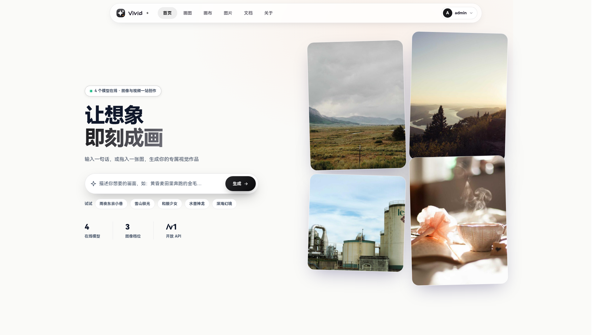
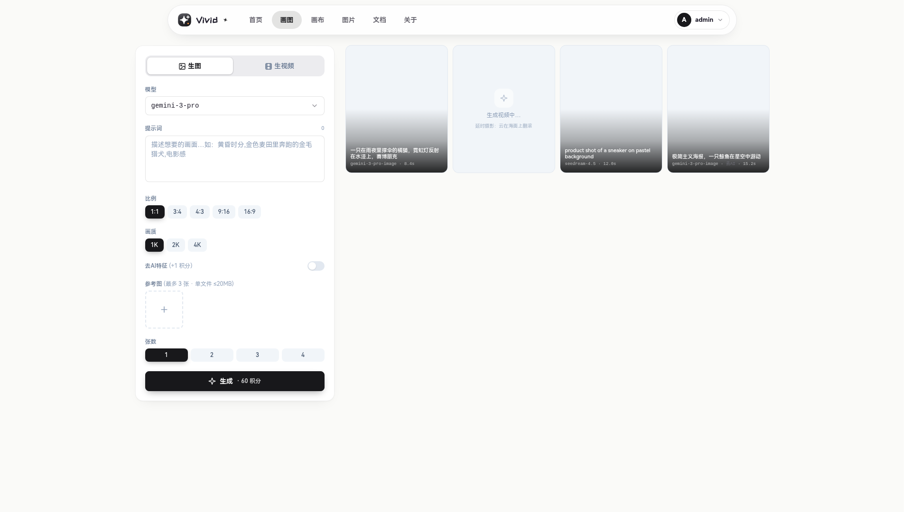
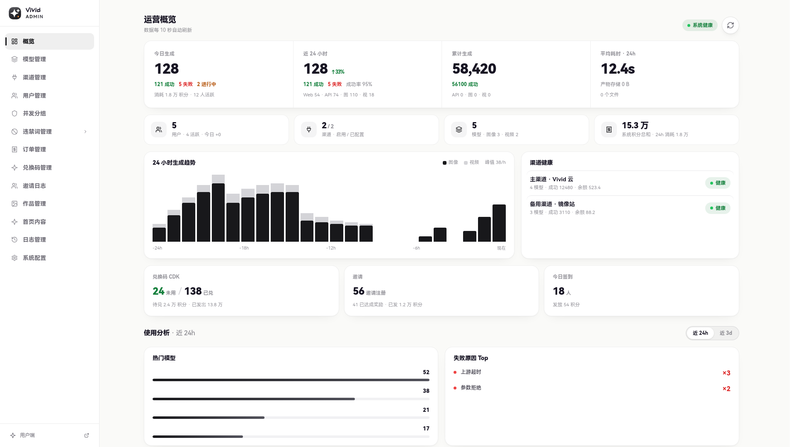
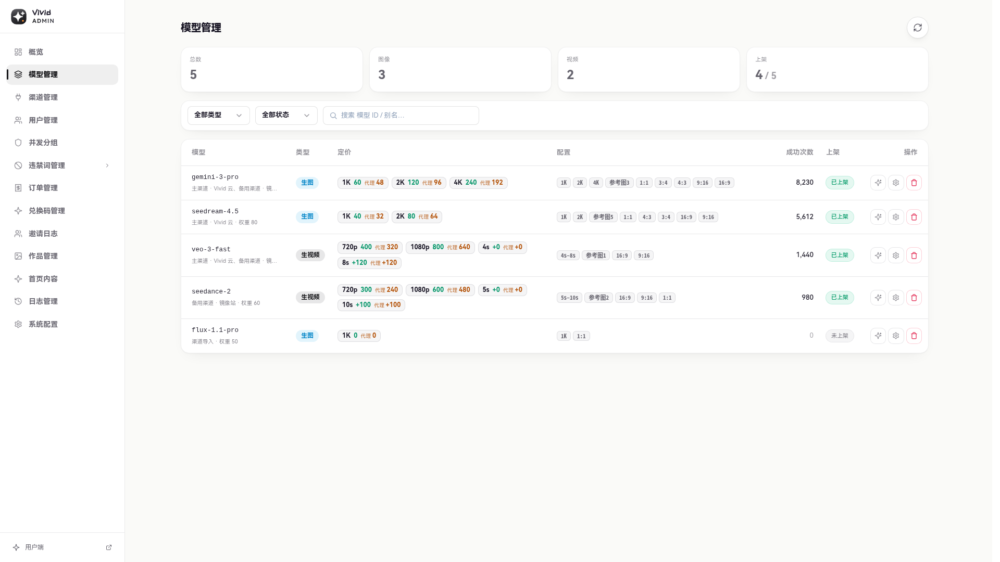
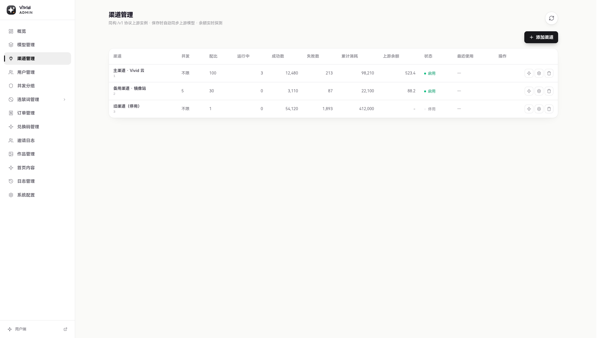
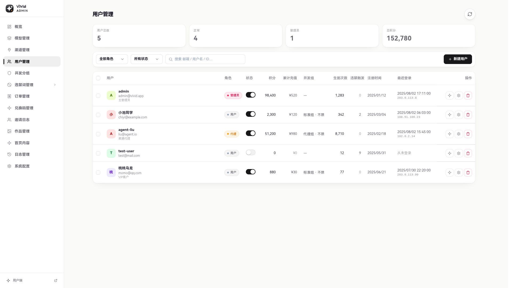
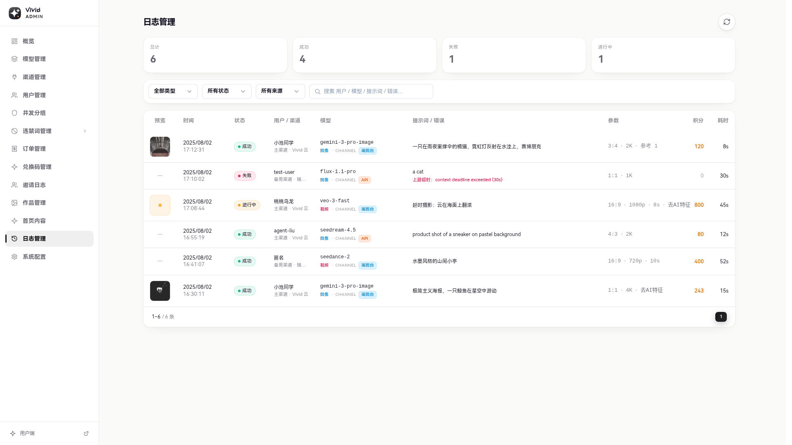

<div align="center">


<h1>image2api</h1>

**vivid-protocol AI image / video generation gateway — channel-based upstream routing, a ready-to-run operations system**

<sub>Live instance (brand): [Vivid AI · vividai.run](https://vividai.run)</sub>

[简体中文](README.md) | **English**

[](https://vividai.run)

[](https://go.dev)
[](https://vuejs.org)
[](#-deployment)
[](#-deployment)
[](#-license)

[Live Demo](https://vividai.run) · [Features](#-features) · [Deploy](#-deployment) · [API](#-vivid-protocol-api)

<br/>



</div>

---

## 🖼️ Screenshots

<div align="center">
<sub>✨ Vivid-style light UI · channel routing · data-driven ops dashboard</sub>
</div>

<table>
  <tr>
    <td width="33%"></td>
    <td width="33%"></td>
    <td width="33%"></td>
  </tr>
  <tr>
    <td align="center"><b>🎨 Studio</b><br/><sub>image + video · reference uploads · live pricing</sub></td>
    <td align="center"><b>📊 Dashboard</b><br/><sub>users / volume / channel health / 24h trend</sub></td>
    <td align="center"><b>🧩 Models</b><br/><sub>channel bindings + weights · standard + reseller pricing</sub></td>
  </tr>
  <tr>
    <td width="33%"></td>
    <td width="33%"></td>
    <td width="33%"></td>
  </tr>
  <tr>
    <td align="center"><b>🔌 Channels</b><br/><sub>save-to-sync upstream models · live balance · failover</sub></td>
    <td align="center"><b>👥 Users</b><br/><sub>roles / concurrency groups / credits · batch ops</sub></td>
    <td align="center"><b>📜 Logs</b><br/><sub>success / failed / running · prompts and latency kept</sub></td>
  </tr>
</table>

## ✨ Introduction

**image2api** is a homogeneous gateway. Upstream, it connects any number of **vivid-protocol (vividai) instances** as "channels" and routes jobs across them. Downstream, it exposes the same **vivid-protocol API** to callers: `POST /v1/generate` (NDJSON stream) · `POST /v1/uploads` (presigned upload) · `GET /v1/models` · `GET /v1/balance`. No built-in provider code, no account pools — an upstream is just another vividai instance, so gateways can be layered arbitrarily.

It is more than a gateway: built-in **credit billing, CDK top-ups, online payment (epay), invite rewards, reseller pricing, user accounts, an admin console and a modern generation UI** — one command turns it into a production AI generation site. The author's live instance **[Vivid AI · vividai.run](https://vividai.run)** runs on this project.

> 💡 Frontend + backend fully open source (MIT). Go + Vue 3.

**One-liner** 🔁 vivid-protocol channel mesh · 📦 save-a-channel syncs all models · 💳 credits + payment + reseller pricing · 🧩 concurrency groups · 🎨 generation UI + admin console · 🐳 one-command deploy

## 🚀 Features

#### 🎨 Generation
- Image + video in one place, with multi-modal references (images / first-last frames / video / audio) per model capability
- Multiple resolutions (1K/2K/4K images · 720p/1080p/768p video), aspect ratios, discrete or per-second video durations — all per-model configurable and priced
- **Priced = listed**: no enable switch — a model goes public once every tier is priced and an enabled channel serves it
- **Model aliases**: one upstream model can map to several public ids
- Optional **de-AI** post-processing on generated images (per-tier surcharge)

#### 🔁 Channel routing
- **Save = full sync**: storing a channel pulls the upstream `/v1/models`, binds everything, unbinds what disappeared and deletes orphans
- **Weight + concurrency-aware** dispatch with failover; upstream 4xx rejections pass through in Chinese, transient errors move to the next channel
- Channel keys stored AES-GCM encrypted (`CHANNEL_SECRET`); upstream balance probed live

#### 🔌 vivid-protocol API
- `POST /v1/generate` — NDJSON stream: first frame returns `jobId`, ~25s blank-line heartbeats, terminal `succeeded`/`failed`
- `POST /v1/uploads` — presigned PUT direct-to-storage for reference files
- `GET /v1/models` — bare array with capability specs · `GET /v1/balance` — balance
- **jobId reconnect**: resubmit with only `jobId` to resume a dropped stream — no duplicate job or charge; pending jobs resume after a server restart too
- Unified errors `{"error":{"code","message"}}` (4001 rejected / 4002 insufficient / 4011 unauthorized / 4293 concurrency / 5001 server); API keys are `vk_` + 48 hex

#### 💳 Billing & operations
- Credits (pre-charge + auto-refund), per model/tier/duration pricing; de-AI surcharge per tier
- **Reseller pricing**: reseller role + per-model reseller prices (API calls included)
- **Online payment (epay)**: WeChat/Alipay QR, fixed + custom amounts, unpaid orders auto-cancel after 30 min, MD5-verified idempotent callbacks
- **CDK codes** · invite rewards · email register / verification / password reset
- **Concurrency groups**: per-group in-flight caps across UI + API (`0` = unlimited)
- Roles: user / reseller / admin

#### 🛠️ Admin console
- Dashboard (trends / DAU / top failures / top spenders)
- **Channels** (save-to-sync, upstream balance, enable, concurrency, weight) · models (standard + reseller pricing, aliases, read-only listable state) · concurrency groups · orders · global logs · users · CDK · media manager · showcase · announcements · site config
- **Banned words**: prompt hits rejected, per-word / per-user trigger stats

**🧰 Engineering**: S3/RustFS media behind an authenticated proxy + retention cleanup · presigned reference uploads · self-healing maintenance (stale-job resume/refund, expired file pruning) · one-command Docker deploy (TLS is your reverse proxy's job).

## 🔌 Channel architecture

```
caller ──vivid protocol──▶ image2api ──vivid protocol──▶ upstream vividai A (weight w, conc c)
                          (this host)                  ├─ upstream vividai B
                                                       └─ …any number
```

- A channel = a homogeneous upstream: `base_url` + `vk_` key + enable switch + concurrency cap + routing weight
- Models come from the upstream `/v1/models` sync; locally they only get aliases and pricing; **one model can fail over across channels**
- This service speaks the same protocol externally — it can itself be mounted as someone's channel, infinitely nestable
- **No OpenAI-protocol upstreams**: a channel must be a vivid-protocol instance

## 📡 vivid-protocol API

```bash
# generate — NDJSON stream; first frame returns jobId
curl -N https://your-domain/v1/generate \
  -H "Authorization: Bearer vk_xxxxxxxx" \
  -H "Content-Type: application/json" \
  -d '{"model": "seedance-2.0", "prompt": "a cute cat on a desk", "ratio": "16:9", "quality": "720p"}'
# → {"jobId":"…","status":"running"}  …heartbeats…  {"status":"succeeded","outputs":[{"url":"…"}]}

# reconnect — resubmit with only jobId, no duplicate job
curl -N https://your-domain/v1/generate -H "Authorization: Bearer vk_xxxx" -d '{"jobId":"<jobId>"}'

# reference files — presigned upload session, then PUT the bytes
curl https://your-domain/v1/uploads -H "Authorization: Bearer vk_xxxx" -d '{"kind":"image","mime":"image/png"}'

curl https://your-domain/v1/models  -H "Authorization: Bearer vk_xxxx"
curl https://your-domain/v1/balance -H "Authorization: Bearer vk_xxxx"
```

Full parameters, the error-code table and Python examples live on the in-app **/docs** page.

## 🚀 Deployment

**Docker (recommended)**: `docker compose up -d --build` brings up PostgreSQL + Redis + RustFS + backend + frontend (nginx listens on container **HTTP :2000**); point your reverse proxy at `http://<host>:2000`.

> ⚠️ Change the secrets in `docker-compose.yml` before deploying — especially **`CHANNEL_SECRET`** (encrypts stored channel keys; rotating it makes saved keys undecryptable).

Manual build needs PostgreSQL · Redis · RustFS (or any S3) · a reverse proxy — see `backend/.env.example` for all env vars.

After deploy: admin → Channels → add channel (upstream URL + `vk_` key) → models auto-sync → price them in 模型管理 → done.

## 🧱 Stack

| Layer | Tech |
|---|---|
| Backend | Go · gin · gorm (PostgreSQL) · go-redis |
| Frontend | Vue 3 · Vue Router · Vite · Tailwind CSS v4 |
| Infra | PostgreSQL · Redis · RustFS (S3-compatible) · Nginx |

## 💬 Contact

| | |
|---|---|
| 🌐 Site | **[vividai.run](https://vividai.run)** |
| 👥 QQ group | **1106849765** · [join](https://qm.qq.com/q/976LeMFoHu) |
| 🐧 QQ | **1114639355** · [add](https://qm.qq.com/q/ItgCcNA7ac) |
| ✉️ Email | vividairun@gmail.com |

## 📄 License

MIT — see [LICENSE](LICENSE).
